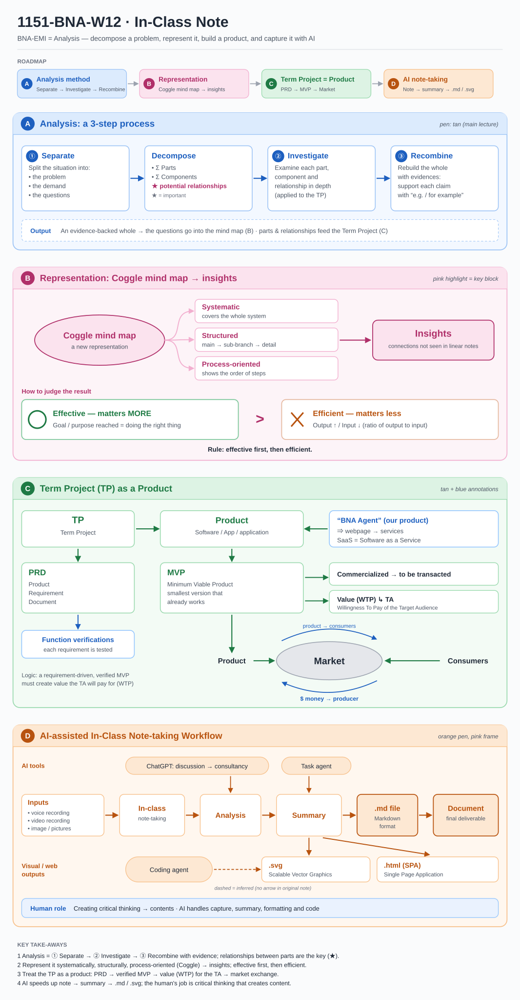
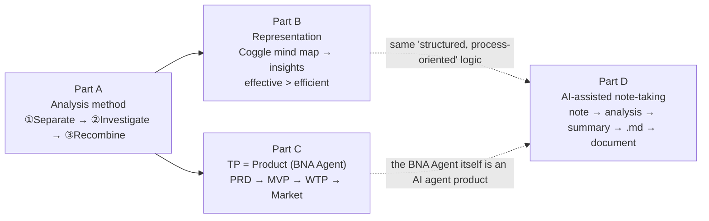
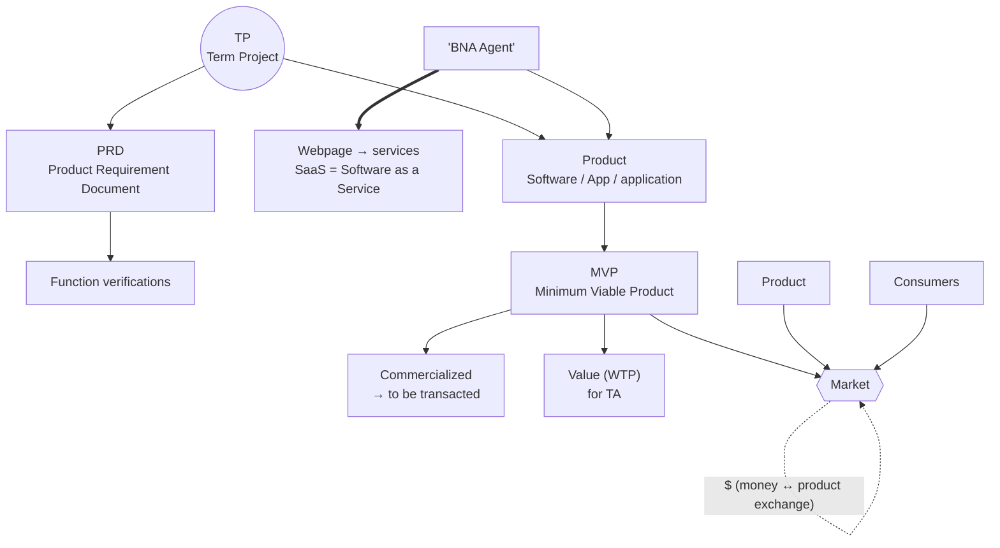
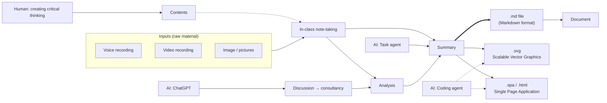

# 1151-BNA-W12 — In-Class Note KB

> **Course:** BNA (Business & News Analysis) — EMI (English-Medium Instruction)
> **Week:** 12 (Semester 1151)
> **Source:** 1-page handwritten note (`W12.pdf`), transcribed and restructured
> **Status:** v2 — user-confirmed readings applied; one open item left (grey highlights, see §7)

---

## 📊 Diagram



> Portrait overview of the whole note: Roadmap → A Analysis → B Representation → C Term Project as Product → D AI note-taking → Key take-aways.

---

## 0. How to read this note

### 0.1 Colour legend (as used in the handwritten original)

| Colour in note | Role (my reading) | Where it appears |
|---|---|---|
| **Tan / beige pen** | Main lecture content — the core framework | Analysis steps ①②③, Σ Parts / Σ Components, TP, MVP, Market, effective vs. efficient |
| **Blue pen** | Supplementary annotations — definitions, abbreviations, side explanations | PRD, function verifications, webpage → services, SaaS, the `$` loop around Market, "creating critical thinking → contents" |
| **Orange-brown pen** | A separate sub-topic: AI-assisted note-taking workflow; also the O / X priority marks | The boxed area (AI tools, in-class note → summary → .md → document, .svg / .spa) and the O / X before effective / efficient |
| **Asterisk `*`** | "Important" marker | Before "relationship" in Σ Parts / Σ Components |
| **Pink / mauve highlighter** | Key concepts (emphasis blocks) | "TP" circle, the "coggle mindmap" cloud, the frame around the AI note-taking box |
| **Grey highlighter** | Emphasis on key nouns ⚠️ | "Product" (after "BNA Agent"), "Market", and a long horizontal bar across the middle-left |

### 0.2 Legend for this KB

- **[verbatim]** = written in the note
- **[confirmed]** = reading confirmed by you
- **[inferred]** = my interpretation of an arrow, bracket, or abbreviation (not written explicitly)
- ⚠️ = still ambiguous; listed in §7

---

## 1. Big picture — one-sentence summary

**BNA = Analysis**: break a problem into parts (①Separate), study the parts and their relationships (②Investigate), rebuild them with evidence (③Recombine), and present the result as a *systematic, structured, process-oriented* representation (e.g., a Coggle mind map) to generate **insights** and reach the goal **effectively**. The class then applies this to the **term project (TP) = a product (the BNA Agent)**, framed by **PRD → MVP → value (WTP) → Market**, and to **AI-assisted note-taking** that turns class notes into Markdown documents and web outputs.



---

## 2. Part A — Analysis as a 3-step process (tan)

### 2.1 Transcription [verbatim]

```
BNA-EMI
  =
Analysis
  ↓
① Separate
   [ the problem
     the demand
     the questions ]  ──→  [ Σ Parts      potential
                             Σ Components * relationship ] ──→ "TP"
                                          (* = important)
                                                                  │
② investigate  ←──────────────────────────────────────────────────┘
③ recombine
   with evidences
   (e.g., for example)
```

### 2.2 Structured process

| Step | Action | What you do | Output |
|---|---|---|---|
| — | **Analysis** (分析) | The core of BNA; "BNA-EMI = Analysis" | — |
| **①** | **Separate** (拆解) | Split the situation into **the problem**, **the demand**, and **the questions** | A clear list of what is being asked and why |
| → | Decompose further | Turn them into **Σ Parts** and **Σ Components**, and identify their **potential relationships** — marked `*` **important** [confirmed] | A set of building blocks + how they may connect |
| **②** | **Investigate** (調查／探究) | Examine each part/component (and their relationships) [inferred] | Facts and findings per part |
| **③** | **Recombine with evidences** (以證據重組) | Put the parts back together, supporting every claim with evidence — "e.g., for example" | An evidence-backed whole (argument, model, or product design) |

### 2.3 Why it works [inferred]

- **Separate** prevents answering the wrong question — you first confirm *problem vs. demand vs. question*.
- **Σ (sum of) parts / components** reminds you the whole = the parts **plus** their relationships. The lecturer starred the **relationships** as the important point: analysing parts without relationships loses the system view.
- **Recombine with evidence** turns analysis into something verifiable: each statement should come with an example or data point ("e.g.").

> 🔗 **Link to your BNA Agent PRD:** this maps directly onto the Agent workflow — *Search / Filter & Organize* ≈ ① Separate, *Analyze* ≈ ② Investigate, *Automated Verification / Present* ≈ ③ Recombine with evidence. [inferred — not in the note]

---

## 3. Part B — Representation: Coggle mind map → insights (pink cloud + tan)

### 3.1 Transcription [verbatim]

```
the questions ──→ coggle mindmap            (pink highlighted cloud)
                    { systematic
  a new             { structured
  representation    { process-oriented
       ↓                  ↓
   insights         O effective  ──→ goal / purpose reached
                    X efficient   ·  output ↑ / input ↓
                    (O = matters more, X = matters less; the second "x" is just a bullet)
```

### 3.2 Structured content

**What:** Present the analysis as a **Coggle mind map** — a *new representation* of the material.

**Three required qualities of the representation:**

1. **Systematic** (系統性) — covers the whole system, nothing important missing
2. **Structured** (結構化) — clear hierarchy: main branch → sub-branch → detail
3. **Process-oriented** (流程導向) — shows the order / flow of steps, not just a list of facts

**Why:** A new representation of the same information → reveals connections you did not see in linear notes → **insights** (洞見).

### 3.3 Effective vs. Efficient (orange O / X marks)

| | **Effective** (有效能) | **Efficient** (有效率) |
|---|---|---|
| Mark in note | **O** (higher priority) | **X** (lower priority) |
| Definition | **Goal / purpose reached** — doing the *right* thing | **Output ↑ / Input ↓** — doing things with the least resources (ratio of output to input) |
| Teaching point [confirmed] | **Matters more.** The mind-map / analysis process is judged first by whether it reaches the goal | **Matters less** than effectiveness: still useful, but secondary |

> Rule of thumb: **effective first, then efficient.** Be sure you reach the goal before trying to do it faster or cheaper.

**Common mistake [inferred]:** Equating "fast" with "good". A very efficient analysis that answers the wrong question (skipping ① Separate) is not effective.

---

## 4. Part C — TP = Product: from PRD to MVP to Market (tan + blue)

### 4.1 Transcription [verbatim]

```
"TP" = Product (Software / App / application)
 ↓          ↑
PRD        "BNA Agent" ⟹ webpage → services
 · Product                 SaaS → Software as a Service
 · Requirement
 · Document → function verifications
            ↓
     MVP: Minimum Viable Product ──→ commercialized, to be transacted
            │                  ──→ value (WTP) ↳ TA
            ↓
  product → [ Market ] ← consumers
              ↻ $ ↺
```

### 4.2 Structured process



### 4.3 Key concepts

| Concept | Full name | Meaning in this lecture |
|---|---|---|
| **TP** | Term Project [confirmed] | The class project — treated as a **product** |
| **Product** | — | Here a **software / app / application**; concretely the **BNA Agent** |
| **BNA Agent → webpage** | — | The agent is delivered as a **webpage** that provides **services** |
| **SaaS** | Software as a Service（軟體即服務） | Delivery model: users access software online as a service rather than installing it |
| **PRD** | Product Requirement Document（產品需求文件） | Defines what the product must do; each requirement leads to **function verifications** (功能驗證 — test that each function works as specified) |
| **MVP** | Minimum Viable Product（最小可行產品） | The smallest version that already works and can be **commercialized / transacted** (someone is willing to pay for it) |
| **WTP** | Willingness To Pay（願付價格） | The **value** of the MVP is measured by what the **TA** is willing to pay |
| **TA** | Target Audience（目標受眾） [confirmed] | The intended users/customers |
| **Market** | — | Where **product** (supply) meets **consumers** (demand); the blue loop + `$` shows the exchange: product flows to consumers, money flows back |

### 4.4 Logic chain [inferred]

1. Treat the term project as a **real product**, not just an assignment.
2. Write the **PRD** → every requirement must be **verifiable** (function verification).
3. Build an **MVP** — minimum, but *viable*: it must create **value the TA would pay for (WTP)**.
4. Only something with WTP can be **commercialized and transacted** in a **market**, where product meets consumers in exchange for `$`.

> 🔗 **Link back to Part A:** ① Separate "the demand" ↔ consumers' demand in the Market; ③ "recombine with evidences" ↔ function verifications in the PRD. [inferred]

---

## 5. Part D — AI-assisted in-class note-taking workflow (orange box, pink frame)

### 5.1 Transcription [verbatim]

```
        ┌─→ ChatGPT ──→ discussion → consultancy
   AI ──┼─→ task agent ─────────┐        ↓
        └─→ coding Agent        │     analysis ──────────→ • svg (scalable vector graph[ics])
                                ↓        ↓                 • spa (single page app) / .html
   In-class note (-taking) ──→ summary
                                ⇓
                          (.md) file — markdown format
                                ↓
                           ( • document )

   Inputs:  · voice recording
            · video recording
            · image / pictures

   (blue)  creating critical thinking ──→ • contents
```

### 5.2 Structured workflow



### 5.3 Steps

| Step | Who / what | Action | Output |
|---|---|---|---|
| 1 | Human + devices | Capture class: **voice recording, video recording, images/pictures** | Raw inputs |
| 2 | Human | **In-class note-taking** | Raw notes (like this handwritten page) |
| 3 | **ChatGPT** | **Discussion → consultancy** [confirmed]: talk through the material, then use it as a consultant for advice | Deeper **analysis** |
| 4 | **Task agent** | Turns notes + analysis into a **summary** | Summary |
| 5 | — | Save as **.md (Markdown) file** | Knowledge-base file (e.g., this KB) |
| 6 | — | Convert to a **document** (circled = final deliverable) | Document |
| 7 | **Coding agent** [inferred] | Turn the summary into visual/web outputs | **.svg** (Scalable Vector Graphics) or **SPA** (Single Page Application, a single **.html** file) |

### 5.4 The human role (blue)

- **Creating critical thinking → contents**: AI handles recording, summarising, formatting and coding; the human's value is producing **content shaped by critical thinking** — judging, questioning, connecting. [confirmed]
- **Corrections to spelling in note:** "scalable vector graph" → *Graphics*; "sigle page app" → *Single Page Application*.

---

## 6. Cross-part relationships (how the four parts connect)

| From | To | Relationship [inferred unless marked] |
|---|---|---|
| Part A ① "the questions" | Part B Coggle mind map | **[verbatim arrow]** The separated questions are organised in the mind map |
| Part A (Σ Parts/Components) | Part C "TP" | **[verbatim line]** The decomposition feeds the term project |
| Part C "TP" | Part A ② investigate / ③ recombine | **[verbatim arrows]** The TP is investigated and recombined with evidence |
| Part B (systematic, structured, process-oriented) | Part D (.md summary) | Same quality standard: the KB file should itself be systematic, structured, process-oriented |
| Part B pink cloud | Part D pink frame | Same pink highlighter → both are the lecture's key take-home blocks |
| Part C BNA Agent (AI product) | Part D AI agents | The product you build *is* an AI agent; Part D shows agents used for your own learning |
| Part B effective vs. efficient | Part D | Using AI raises efficiency, but the goal is effectiveness — insight and critical thinking |

---

## 7. Confirmation log

| # | Location | Final reading | Status |
|---|---|---|---|
| 1 | Pink circle "TP" | **Term Project** | ✅ confirmed |
| 2 | "Σ Pants potential * relationship" | **Σ Parts / Σ Components; `*` = important → potential relationships** | ✅ confirmed |
| 3 | O / X marks | **Effective matters more than efficient**; the "x" before output/input is just a bullet | ✅ confirmed |
| 4 | Above "analysis" | **discussion → consultancy** (user: "maybe") | ✅ best reading |
| 5 | "↳ TA" under value (WTP) | **Target Audience** | ✅ confirmed |
| 6 | Blue "creating critical thinking → contents" | **The human's job (vs. AI) is to create content through critical thinking** | ✅ confirmed |
| 7 | Grey bar on "Product"; long grey bar middle-left | Currently treated as **emphasis** on "Product" and a **section divider** | ⚠️ open |
| 8 | Coding agent → .svg / SPA | No arrow in the note; inferred | [inferred] |
| 9 | "commercialed" | **commercialized** | spelling fix |

---

## 8. Key take-aways (quick review)

1. **Analysis = ① Separate → ② Investigate → ③ Recombine with evidence.**
2. Separate into **problem / demand / questions**, then into **Σ parts + Σ components + their relationships** (relationships starred as important).
3. Present results as a **systematic, structured, process-oriented** representation (Coggle mind map) → **insights**.
4. **Effective** (reach the goal) matters more than **efficient** (output/input): effective first, then efficient.
5. **TP = a product** (software/app — the BNA Agent, delivered as a webpage / SaaS).
6. **PRD** → requirements → **function verifications**.
7. **MVP** must create **value (WTP)** for the **TA** so it can be **commercialized / transacted** in the **market** (product ↔ consumers ↔ $).
8. **AI note-taking pipeline:** recordings/images → notes → (ChatGPT discussion, task agent) → analysis → summary → **.md** → **document**, or → **.svg / SPA .html** via coding agent.
9. **Human value = critical thinking that creates content.**

---

## 9. Glossary

| Term | Full name | 中文 |
|---|---|---|
| BNA | Business & News Analysis | 商業與新聞分析 |
| EMI | English-Medium Instruction | 全英語授課 |
| TP | Term Project | 期末專題 |
| PRD | Product Requirement Document | 產品需求文件 |
| MVP | Minimum Viable Product | 最小可行產品 |
| WTP | Willingness To Pay | 願付價格 |
| TA | Target Audience | 目標受眾 |
| SaaS | Software as a Service | 軟體即服務 |
| SVG | Scalable Vector Graphics | 可縮放向量圖形 |
| SPA | Single Page Application | 單頁應用程式 |
| .md | Markdown | Markdown 標記語言檔 |
